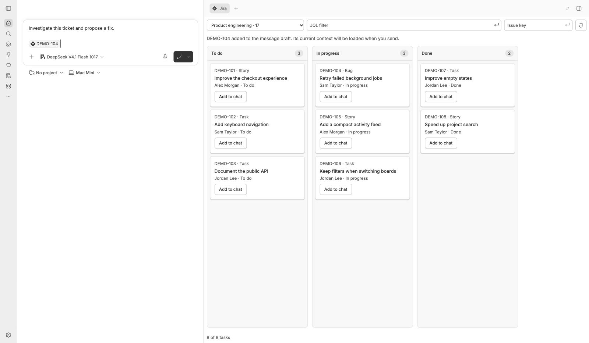
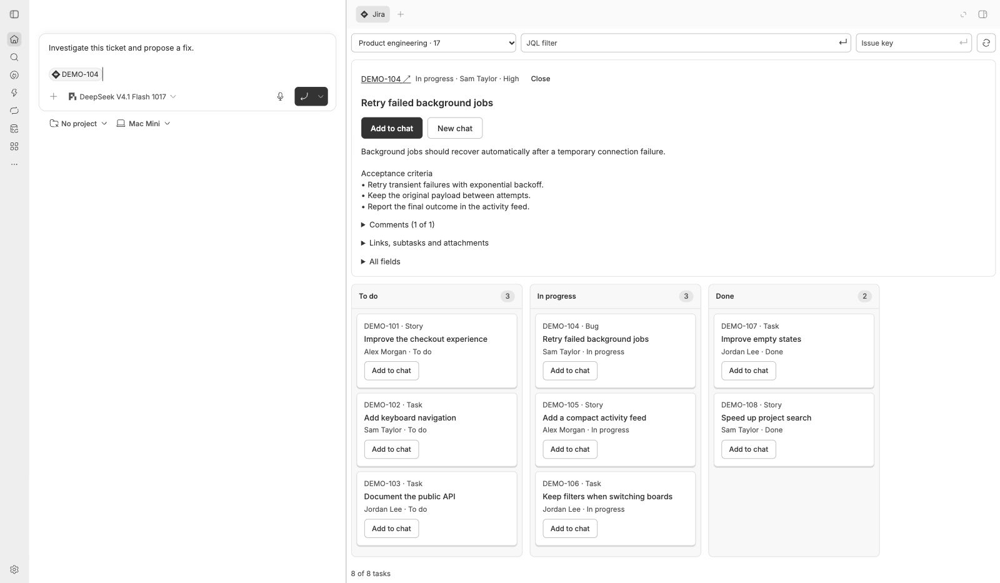

<div align="center">

# Jira Boards for BB

[English](README.md) · **Русский**

**Ваша доска Jira. Ваш диалог. Одно рабочее место.**

Откройте Kanban-доску рядом с чатом, перетащите тикет в сообщение и дайте агенту контекст, с которого он начнёт.

[](https://github.com/viartemev/bb-jira/actions/workflows/ci.yml)
[](https://github.com/viartemev/bb-jira/releases)
[](LICENSE)

[Установка](#установка) · [Подключение](#подключение-jira) · [Как пользоваться](#как-пользоваться) · [Инструменты агента](#инструменты-агента) · [Если что-то не работает](#если-что-то-не-работает)

</div>



*Снято на работающем плагине с вымышленными демонстрационными данными. Скриншоты показывают текущую основную ветку; в тегированных релизах интерфейс может быть старше.*

## Доска — прямо в диалоге

- **Настоящая боковая панель.** Jira открывается на всю высоту вкладки рядом с Browser и Terminal. Диалог остаётся на виду.
- **Привычная Kanban-доска.** Горизонтальные колонки статусов, закреплённые заголовки и сворачиваемые дорожки по исполнителям. Все страницы задач загружаются автоматически.
- **Быстрые фильтры доски.** Используйте фильтры, уже настроенные в Jira, комбинируйте несколько или добавляйте свой JQL.
- **Компактная панель управления.** Выбор доски, JQL-фильтр, открытие тикета по ключу или ссылке и обновление доски — в одной строке.
- **Перетаскивание тикета в чат.** Бросьте карточку в поле ввода или нажмите **Add to chat**. Набранный черновик не пострадает.
- **Свежий контекст при отправке.** Упоминание Jira превращается в поля тикета, описание, комментарии, связи, подзадачи и метаданные вложений.
- **Запись, когда она действительно нужна.** Оставьте комментарий или проведите тикет по workflow из панели тикета либо попросите об этом агента; права и правила workflow Jira по-прежнему решают, что пройдёт.
- **Инструменты для следующего вопроса.** Агенты могут читать отдельные поля, следующие страницы комментариев и другие тикеты, а также комментировать и переводить статус, когда вы об этом попросите.

Независимый community-плагин для [BB](https://getbb.app). Не связан с Atlassian.

## Установка

Нужны **BB 0.47+** и доступный экземпляр Jira Software. Совместимость плагина и SDK BB проверяет при установке.

```sh
bb plugin install https://github.com/viartemev/bb-jira.git
```

BB скачает зависимости, соберёт плагин и включит его. Чтобы обновить установку, которая следует за основной веткой:

```sh
bb plugin update jira-boards --yes
```

Плагин устанавливается как **Jira Boards** (`jira-boards`). В прошлых версиях
он назывался `jira`: удалите ту установку (`bb plugin remove jira`) и после
установки этой заново введите URL Jira и токен — BB хранит настройки и
секреты отдельно для каждого плагина.

## Подключение Jira

Откройте **Settings → Plugins → Jira Boards**.

| Настройка | Что ввести |
| --- | --- |
| **Jira deployment** | **Data Center / Server** или **Cloud** |
| **Jira URL** | Адрес вашего сайта по HTTPS, включая контекстный путь, например `https://jira.example.com/jira` |
| **Personal access token / Cloud API token** | Токен вашей учётной записи Jira; BB хранит его как секрет |
| **Atlassian account email** | Только для Cloud: почта учётной записи, создавшей токен |
| **Board IDs** | ID через запятую, например `17, 42`; оставьте пустым, чтобы видеть доступные доски |

ID доски есть в её адресе: `rapidView=17` или `/boards/17`.

Кнопка **Test connection** в настройках проверяет сохранённые учётные данные. **Refresh boards** перезагружает доски и задачи в открытых вкладках Jira. Блок статуса показывает, сохранён ли токен: скрытое значение или `[set]` означают, что вводить его заново не нужно.

Сервер BB должен иметь доступ к Jira по HTTPS, включая необходимый VPN и доверенный корпоративный TLS-сертификат. Никогда не вставляйте токен в чат или команду оболочки.

<details>
<summary><strong>Подробности аутентификации</strong></summary>

- **Server / Data Center:** режим PAT отправляет `Authorization: Bearer`. Поддержка PAT и Agile API, которые использует плагин, есть в Jira Software 8.14+.
- **Cloud:** используются почта учётной записи Atlassian и classic-токен без scope, запросы идут на адрес сайта. Токены со scope через шлюз Atlassian и OAuth не реализованы. Поиск упоминаний идёт через `/rest/api/3/search/jql`.
- Переключение типа развёртывания обновляет форму настроек, сохраняя введённые значения. Поле почты появляется только для Cloud.

Сценарий Server / Data Center проверен на живом экземпляре Jira. Аутентификация и обработка ответов Cloud покрыты автотестами на фикстурах.

</details>

## Как пользоваться

### Открыть доску

Откройте боковую панель BB, выберите **+ → Jira** и нужную доску. В существующих тредах в заголовке тоже есть действие **Jira**.

Прокручивайте по горизонтали, чтобы увидеть другие колонки статусов, или расширьте панель. У каждого исполнителя своя сворачиваемая дорожка с задачами в соответствующих колонках. Задачи без исполнителя идут отдельной дорожкой.

Все страницы загружаются автоматически, поэтому активная работа со следующих страниц не прячется за первой страницей закрытых задач. В подвале видно **загружено / всего** и прогресс загрузки; когда загрузка завершена, счётчики полные.

### Фильтровать, искать, обновлять

Верхняя панель держит управление рядом:

- **Выбор доски:** переключение между досками, доступными вашей учётной записи.
- **JQL-фильтр:** введите запрос и нажмите **Enter** или маленькую стрелку.
- **Ключ тикета:** введите `DEMO-104` или ссылку вида `/browse/...` и нажмите **Enter**, чтобы открыть тикет.
- **Иконка обновления:** перезагружает выбранную доску с применённым фильтром. Загрузка снова начинается с первой страницы и сама проходит остальные.

Если доска отдаёт быстрые фильтры, их названия появляются компактными кнопками под панелью. Нажатие включает и выключает фильтр, **Clear filters** сбрасывает выбор. Выбранные быстрые фильтры и ручной JQL объединяются через **AND**. Если Jira не отдаёт быстрые фильтры, доска и ручной JQL продолжают работать.

Например, показать свою незакрытую работу:

```jql
assignee = currentUser() AND resolution = Unresolved
```

### Дать агенту тикет

Перетащите карточку с доски в поле ввода сообщения. Пока поле принимает карточку, оно подсвечивается. В черновике появится упоминание Jira; допишите просьбу и отправляйте.

> Разберись с этим багом, объясни причину и предложи исправление.

**Add to chat** делает то же самое без перетаскивания, в том числе на тач-устройствах. Можно также набрать **@** в композере и найти тикет по ключу или тексту. **New chat** открывает новый черновик с просьбой агенту прочитать тикет.



*Детали тикета с той же вымышленной демонстрационной доски. Добавление тикета никогда не отправляет сообщение само.*

## Инструменты агента

| Инструмент | Что делает |
| --- | --- |
| `jira_issue(key, field?, offset?)` | Читает контекст тикета или отдельное поле кусками по 40k символов |
| `jira_comments(key, startAt?)` | Читает до 50 комментариев и отдаёт смещение следующей страницы |
| `jira_boards(startAt?)` | Перечисляет настроенные доски или страницу доступных |
| `jira_board_issues(boardId, jql?, startAt?)` | Перечисляет до 50 задач доски, при необходимости с JQL |
| `jira_comment(key, body)` | Пишет комментарий от вашей учётной записи Jira |
| `jira_transitions(key)` | Перечисляет доступные на тикете переходы workflow |
| `jira_transition(key, transitionId, comment?)` | Применяет один переход, при необходимости с комментарием |

Встроенный [skill Jira](skills/jira/SKILL.md) объясняет агенту, когда запрашивать контекст, как идти по страницам, что содержимое Jira — это данные, а не инструкции, и что писать можно только по вашей просьбе.

То же подключение доступно из CLI:

```sh
bb jira issue DEMO-104
bb jira boards --start 0
bb jira comment DEMO-104 --body "Выложено на staging"
bb jira transitions DEMO-104
bb jira transition DEMO-104 --to 31 --comment "Готово к ревью"
bb jira --help
```

`--body` и `--comment` понимают `-stdin`, поэтому `pbpaste | bb jira comment DEMO-104 --body-stdin` отправит многострочный текст без возни с кавычками.

## Права и ограничения

Плагин читает Jira и пишет только две вещи: комментарии и переходы workflow. Он не правит описания и поля, не назначает исполнителей и не меняет настройки досок. Перетаскивание карточки добавляет контекст в сообщение и не двигает тикет по статусам.

Каждая запись выполняется от вашей учётной записи Jira, с вашими правами и правилами workflow: переход, который требует экран, обязательное поле или условие, завершается HTTP-ошибкой Jira и ничего не меняет. Агенты пишут только по вашей просьбе; в панели тикета есть явные кнопки **Comment** и **Move**.

- Доступ определяется правами учётной записи, которой принадлежит токен. Список Board IDs фильтрует выбор доски, но не является границей доступа.
- Учётные данные остаются на сервере BB. Содержимое тикета передаётся выбранному вами провайдеру агента, когда вы отправляете упоминание или вызываете инструмент Jira.
- Начальный контекст включает все возвращённые поля, первые 50 комментариев, связи, подзадачи и метаданные вложений. Он ограничен 48k символов с явным уведомлением об обрезке.
- Агент может запросить следующие страницы полей и комментариев. Один комментарий ограничен 60k символов.
- Содержимое вложений, полная история тикета и связанные тикеты автоматически не загружаются. Описания и комментарии показываются простым текстом, включая преобразованный ADF из Cloud.
- Запросы не следуют редиректам, прерываются через 20 секунд, ответы ограничены 8 MiB. Сообщения об ошибках не содержат тела ответа Jira и учётных данных.

## План работ

Что уже можно сделать с тикетом, а что пока нет. Отмеченный пункт есть в текущей версии; остальное — только чтение, вручную в браузере или сырыми вызовами API.

### Чтение

- [x] Тикет целиком: поля, описание, комментарии, связи, подзадачи, метаданные вложений
- [x] Кастомные и большие поля кусками по 40k символов
- [x] Поиск: JQL, меню **@**, страницы комментариев
- [ ] История изменений: кто менял какое поле и двигал статус
- [ ] Вложения: скачивание и просмотр (сейчас только метаданные)
- [ ] «Мои задачи»: на мне, просроченные, недавно открытые, сохранённые фильтры
- [ ] Спринт, эпик, иерархия и бэклог

### Запись

- [x] Комментарий простым текстом (plain text на Server/Data Center, ADF на Cloud)
- [x] Смена статуса на простом workflow
- [ ] Смена статуса, когда экран перехода требует поля (resolution и другие)
- [ ] Комментарий с markdown, кодом, списками и @упоминаниями
- [ ] Редактирование и удаление своего комментария
- [ ] Исполнитель, «назначить на меня»
- [ ] Summary и description
- [ ] Priority, labels, components, fixVersion
- [ ] Due date, оценка, worklog
- [ ] Story points и перенос задач между спринтами
- [ ] Связи: blocks, relates, duplicates
- [ ] Epic link, parent и создание подзадач
- [ ] Создание тикета
- [ ] Создание подзадач по чек-листу
- [ ] Вложение файлов и скриншотов
- [ ] Watch/unwatch и «упомянули меня»
- [ ] Массовые операции по JQL

### Безопасность записи

- [ ] Черновик и подтверждение перед отправкой: запись идёт от вашей учётной записи
- [ ] Отчёт о том, что именно изменилось после записи (сейчас возвращается только новый статус)

Удаление тикетов не планируется.

### Порядок работ

1. Экраны переходов и обязательные поля — иначе кнопка **Move** ненадёжна.
2. Правка summary, description, priority, labels, due date и назначение исполнителя.
3. Создание тикетов и подзадач.
4. «Мои задачи» и сохранённые фильтры.
5. История изменений и вложения.
6. Комментарии с разметкой, правкой и удалением.

## Если что-то не работает

| Симптом | Что проверить |
| --- | --- |
| HTTP 401 | Действительность токена, выбранный тип развёртывания и почту учётной записи для Cloud |
| HTTP 403 или 404 | Права учётной записи, видимость доски или тикета в Jira и допустимость перехода в workflow |
| Сетевая ошибка или ошибка TLS | VPN сервера BB, HTTPS-адрес, контекстный путь и доверие корпоративному сертификату |
| Нет досок | Board IDs и доступ к Jira Software; используйте **Refresh boards** в настройках |
| Нет инструментов агента | Начните новую сессию агента, чтобы BB загрузил инструменты и skill плагина |
| HTTP 429 | Подождите перед повтором: Jira ограничивает частоту запросов |

[Сообщить об ошибке](https://github.com/viartemev/bb-jira/issues/new) — приложите версии BB и Jira и воспроизведение без токенов и приватных данных тикетов.

## Разработка

Нужны Node.js 24 и совместимая установка BB.

```sh
git clone https://github.com/viartemev/bb-jira.git
cd bb-jira
npm ci --include=dev
npm run typecheck
npm test
bb plugin build
```

GitHub Actions запускается на каждый push в `main` и на каждый pull request: проверка типов, тесты и аудит продовых зависимостей (`npm audit --omit=dev --audit-level=high`). Dependabot раз в неделю предлагает обновления npm-пакетов и Actions.

Чтобы выпустить релиз, по ходу работы описывайте изменения в разделе `## Unreleased` файла `CHANGELOG.md`, влейте их в `main` и выполните:

```sh
npm run release -- 0.2.1
git push origin main v0.2.1
```

`npm run release` поднимает `version` в `package.json`, ставит дату на раздел `Unreleased`, делает коммит и тег `v0.2.1`, но ничего не отправляет. Отправленный тег запускает workflow Release: он откажется от тега, который расходится с `package.json` или стоит не на `main`, перезапустит проверку типов и тесты, возьмёт заметки релиза из соответствующего раздела changelog (плюс сгенерированные GitHub), приложит архив исходников и создаст GitHub-релиз. Версия с дефисом, например `0.3.0-rc.1`, помечается как пре-релиз.

В итогах workflow также сказано, попадает ли версия в диапазон маркетплейса. Внутри диапазона обновление доходит до пользователей командой `bb plugin update jira-boards --yes`; для версии вне диапазона (например, `0.3.0` при `^0.2.0`) откройте pull request в [get-bb/marketplace](https://github.com/get-bb/marketplace) и поменяйте `source.git.range` в `entries/jira-boards.json`.

Тесты покрывают аутентификацию, пагинацию, ограничение контекста, валидацию ввода, обработку нативного drag-and-drop, вставку упоминаний и настройки подключения — на фикстурах и публичном тестовом SDK BB.

См. [Contributing](CONTRIBUTING.md), [Changelog](CHANGELOG.md) и [лицензию MIT](LICENSE).
